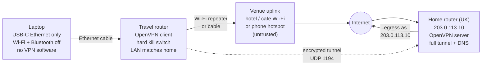

# Location-Hardening a Laptop Against a Host-Resident Observer

**A design and verification case study: making a Windows laptop present as "at home" to any software running on it, wherever it physically is.**

Author: [maren-epochs](https://github.com/maren-epochs) · Status: design complete, verification tooling written, hardware deployment in progress · Last updated: October 2026

---

## Contents

1. [Summary](#1-summary)
2. [The problem and the threat model](#2-the-problem-and-the-threat-model)
3. [Why the obvious answers fail](#3-why-the-obvious-answers-fail)
4. [How location leaks from a laptop: the channel inventory](#4-how-location-leaks-from-a-laptop-the-channel-inventory)
5. [Design decisions](#5-design-decisions)
6. [Architecture](#6-architecture)
7. [The verification tool](#7-the-verification-tool)
8. [Hardware selection](#8-hardware-selection)
9. [Operating procedure](#9-operating-procedure)
10. [Lessons, limitations and Phase 2](#10-lessons-limitations-and-phase-2)

---

## 1. Summary

This project set out to answer a narrow question with an uncomfortable premise: if an application running on my own laptop were trying to work out where the laptop physically is, what would it take to stop it, and how would I know I had succeeded?

The premise matters because it rules out the usual answer. A VPN client on the laptop hides the laptop's address from the internet, but it does nothing about a process on the same machine that can list adapters, enumerate running processes, read the system timezone, or ask the Wi-Fi card what access points it can see. Against that observer, the laptop itself has to be clean.

The design that came out of the work has three parts:

- **The tunnel lives on a separate device.** A pocket-sized travel router carries an OpenVPN connection to a home router in the UK. The laptop connects to the travel router by Ethernet cable and never touches the venue network.
- **The laptop is stripped of everything that could disagree with the story.** Wi-Fi and Bluetooth radios are disabled, the Windows location service is disabled and policy-locked, the timezone is pinned to Europe/London, IPv6 is switched off, browser geolocation and WebRTC are blocked by policy, and no VPN software exists on the machine at all.
- **A fail-loud self-test decides whether the setup is working.** A PowerShell script checks twenty-six conditions, from the public egress address down to whether the Bluetooth radio is present, and exits non-zero if any one of them fails. "Probably fine" is not a state it can report.

The project also produced a reversible, one-command on/off switch for the laptop side, a hardware evaluation that rejected a popular travel router, and a written operating procedure for arriving at a venue.

The rest of this document explains how each of those came about, including the mistakes along the way. Identifying details (addresses, network names, hardware identifiers) have been replaced with placeholders; `203.0.113.10` stands in for the home router's public address throughout.

---

## 2. The problem and the threat model

### 2.1 What "location" means here

A laptop gives away its location through several independent channels, and they are not all the same kind of thing:

- **The public IP address** it uses to reach the internet. Geolocation databases map most consumer addresses to a city with reasonable accuracy.
- **The DNS resolver** it uses. Even behind a VPN, if DNS queries go to the local ISP's resolver, any service that can see which resolver reached it learns the real network.
- **The system timezone.** A machine set to Eastern Time whose traffic exits in London is a contradiction any script can read.
- **Nearby Wi-Fi access points.** Every access point broadcasts a hardware identifier (BSSID). Google, Apple and Microsoft all maintain databases mapping BSSIDs to coordinates; a list of the three or four strongest nearby networks usually resolves to within tens of metres. This is how phones get a fix indoors.
- **Nearby Bluetooth devices.** The same idea, with a smaller database.
- **Local network details.** The subnet, the gateway address, the DHCP server's identity, the connected SSID.

The project's goal was to make every one of these consistent with a single story: *this laptop is on its home LAN, in the UK*.

### 2.2 The observer

The usual privacy guides assume the observer is a website. This project assumed something stronger: a native application on the laptop, with whatever access a normal installed program has, and possibly more. Concretely, the observer was assumed to be able to:

- list running processes and installed services;
- enumerate network adapters, including virtual ones, and read their descriptions;
- read the routing table, the default gateway, the configured DNS servers;
- read the system timezone and locale;
- call the native Windows WLAN API to get the Wi-Fi card's scan results;
- bypass the user-mode consent gate that Windows 11 (build 24H2 and later) puts in front of that scan list.

It was *not* assumed to control the network hardware the laptop plugs into, or the home router at the far end.

The "assume worst case" choice was deliberate. It costs more (a second device, a cable, some inconvenience) but it collapses a long list of partial mitigations into a few structural ones. If the laptop has no Wi-Fi radio active, it does not matter how clever the observer's BSSID-reading code is.

### 2.3 Scope

In scope: the laptop's network and operating-system surface. Out of scope: anything the observer could learn from a webcam, from a photo of a window, from a booking confirmation in an email, or from a phone sitting next to the laptop on venue Wi-Fi. The document is explicit about this in its final section because a design that solves the technical channels and ignores the physical ones gives false confidence.

This is a privacy exercise. It is not designed to defeat any service's terms of use, and nothing in it is specific to any service.

---

## 3. Why the obvious answers fail

Before the design was settled, three conventional approaches were evaluated and rejected. Each is worth recording because each is what a search engine will recommend.

### 3.1 "Just use a VPN"

A VPN client on the laptop creates a virtual adapter (TAP-Windows, Wintun, or a kernel data-channel driver), runs a process (`openvpn.exe`, `wireguard.exe`), and, if configured as a full tunnel, replaces the default route. Websites then see the VPN's exit address.

Against the stated observer this fails on four counts:

1. The VPN process is visible in the process list.
2. The virtual adapter is visible in the adapter list, with a description that names the VPN software.
3. The Wi-Fi adapter is still up and still connected to the venue, so the SSID and the BSSID scan list are still readable.
4. Split-tunnel misconfiguration is common. The existing OpenVPN profile on the laptop, generated by a consumer router, turned out to be split-tunnel: it routed only the home LAN through the tunnel and sent all internet traffic out the local connection. The connection log confirmed it: no `redirect-gateway` option was ever pushed, and only a /30 link route appeared. The laptop had been "on VPN" for months without any internet traffic going through it.

Finding 4 was the single most useful discovery in the project. It was found by reading the client log, not by any leak-test website, because leak-test sites report what the browser sees and the browser was seeing exactly what it would have seen with no VPN at all.

### 3.2 "Turn off location in Settings"

Windows exposes a location toggle and, since build 24H2, gates the Wi-Fi scan API behind the same consent. Setting consent to Deny and disabling the Geolocation Service (`lfsvc`) is correct and the project does both. But the gate is user-mode policy. It stops a well-behaved app from calling `WlanGetNetworkBssList`; it does not stop the Wi-Fi card from scanning, and the project's threat model assumes the gate can be bypassed. The only control that holds under that assumption is a disabled radio.

### 3.3 "Block geolocation in the browser"

Chrome, Edge and Brave can be told by enterprise policy (`DefaultGeolocationSetting = 2`) to refuse the Geolocation API, and a second policy (`WebRtcIPHandling = disable_non_proxied_udp`) stops WebRTC from leaking local addresses. The project sets both. They are correct, cheap and reversible. They also only cover the browser. A native app does not ask the browser's permission for anything.

The pattern across all three is the same: each is a real control over one channel, and each leaves the structural channels (radio on, VPN visible, timezone wrong) untouched. The design therefore treats them as belt-and-braces measures layered on top of a structural fix, not as the fix.

---

## 4. How location leaks from a laptop: the channel inventory

The design was built from an explicit inventory. Each row is a thing the observer can read, what it must show for the story to hold, and the control that makes it show that.

| Signal the observer can read | Must show | Control |
| --- | --- | --- |
| Public IPv4 egress address | The home router's address (`203.0.113.10`) | Full tunnel terminated on the travel router |
| Public IPv6 egress address | None | IPv6 disabled on the laptop and on the travel router's LAN |
| DNS resolver seen by the internet | A UK resolver | Resolver is the home router, reached through the tunnel |
| System timezone | GMT Standard Time (Europe/London) | Pinned; automatic timezone service disabled |
| Nearby Wi-Fi BSSIDs | No list exists | Wi-Fi adapter disabled |
| Nearby Bluetooth devices | No list exists | Bluetooth radio disabled |
| Running VPN processes | None | VPN clients uninstalled |
| Virtual network adapters | None | TAP / Wintun / DCO drivers removed |
| Local subnet and gateway | Same as the home LAN | Travel router's LAN configured to match the home router's LAN |
| Connected SSID | None (wired) | Ethernet only |
| Browser Geolocation API | Denied | Chrome / Edge / Brave policy |
| WebRTC ICE candidates | No raw UDP, no local addresses | Chrome / Edge / Brave policy |
| Windows location consent and service | Deny; service disabled; policy-locked | Registry and service configuration |

Two rows deserve comment.

**IPv6** is the most commonly missed leak. The home router's OpenVPN server is IPv4-only, so any IPv6 route on the laptop bypasses the tunnel entirely. The audit found an IPv6 default route on the laptop's Wi-Fi adapter and a live IPv6 egress address; a dual-stack website would have seen the real ISP prefix with the IPv4 tunnel fully working. The fix is blunt: disable the IPv6 protocol binding on every adapter and disable IPv6 on the travel router's LAN, so no IPv6 path exists to leak through.

**Local subnet** is a speculative row. There is no evidence the observer compares the laptop's current subnet to a baseline it saw at home. But the cost of matching the travel router's LAN to the home router's LAN is five minutes in an admin page, so it is done regardless. Cheap consistency is worth having even against a threat that may not exist.

---

## 5. Design decisions

The design was settled through a structured interview of twenty-five questions, each with enumerated options and a recommendation. The format forced every trade-off to be made explicitly rather than discovered later. The decisions that shaped the result:

| Question | Decision | Reasoning |
| --- | --- | --- |
| Who is the observer? | A native app with worst-case host visibility | Rules out any laptop-resident VPN |
| What should services see? | The home address specifically, not "anywhere else" | A residential UK address is unremarkable; a datacenter VPN exit is flagged by many services |
| Where does the tunnel endpoint live? | On a travel router, not the laptop | The only topology that leaves the laptop with no VPN footprint |
| Which protocol? | OpenVPN now (the home router already serves it); WireGuard later on a dedicated box | Build on what exists, upgrade when throughput or crypto hygiene demands it |
| IPv6? | Disabled everywhere on the laptop side | The tunnel is IPv4-only; any IPv6 path is a bypass |
| Kill switch? | Hard, on the travel router, armed at boot | Fail closed; a dropped tunnel must not silently expose the venue address |
| Laptop reaches the venue LAN? | Never | The laptop must not see any network but the travel router's |
| DNS? | The home router, via the tunnel | Resolver identity then matches the egress address |
| Timezone? | Pinned to Europe/London, auto-timezone off | Must match the egress; UTC would be wrong for seven months of the year under British Summer Time |
| Laptop radios? | Wi-Fi and Bluetooth disabled while away; Ethernet to the travel router | A radio that is on produces the BSSID list, whatever the OS consent says |
| Verification standard? | Scripted, fail-loud, exit code equals failure count | "Looks fine" is not an acceptable state |
| Outage behaviour? | Notify; no automatic fallback; user refrains from sensitive use | A silent fallback to the venue connection is the worst possible failure mode |

The timezone row illustrates how the interview caught errors. The first instinct was to pin the clock to UTC, since the home router is in the UK. UTC equals London time only in winter; from late March to late October the UK is on BST (UTC+1), and a UTC-pinned clock would mismatch the egress address for seven months of the year. Windows' "GMT Standard Time" zone follows the DST transition automatically and is the correct choice.

The radio row was added after the initial design, when a review pointed out that moving the VPN off the laptop hides the VPN but does nothing about the Wi-Fi card. That observation changed the laptop-to-router link from Wi-Fi to Ethernet and added a USB-C Ethernet adapter to the shopping list, because the laptop has no Ethernet port.

---

## 6. Architecture

Reading it left to right:

**The laptop** has one wired link to the travel router and nothing else. From the laptop's point of view the network looks like home: a private gateway on the home subnet, a private DNS server, no IPv6, an Ethernet adapter. There is no Wi-Fi adapter to query, no Bluetooth radio to scan, no VPN process, no virtual adapter.

**The travel router** does all the work. Its upstream side joins the venue network, either over Wi-Fi in repeater mode or by cable if the venue offers a jack. It brings up an OpenVPN tunnel to the home router at boot. Its firewall refuses to forward any LAN traffic except through the tunnel, so if the tunnel drops the laptop simply loses internet rather than falling back to the venue connection. Captive portals, which need a plain connection to complete a login page, are handled on the router's own admin page through a temporary bypass that applies to the router and not to the laptop.

**The venue network** is untrusted and only the travel router ever sees it. The router does scan nearby access points to find its uplink; that is acceptable because the observer runs on the laptop and the router's view never reaches it.

**The home router** terminates the tunnel, forwards traffic to the internet from its own public address, and answers DNS. Its OpenVPN server was already in place; the only change needed was switching its client-access mode from "home network only" to "internet and home network", which is what turns a split tunnel into a full one.

The whole design rests on one asymmetry: the observer is on the laptop, and the laptop is the one device in the chain that is deliberately kept ignorant.

---

## 7. The verification tool

The self-test is the part of the project most directly transferable to other work, so it is described in some detail here. It is a single PowerShell script with eight modes.

### 7.1 Modes

| Mode | Elevation | What it does |
| --- | --- | --- |
| `Audit` | No | Read-only report of every local control. Does not touch the network. |
| `Apply` | Yes | Writes a JSON backup of current values, then applies every persistent setting. |
| `Revert` | Yes | Restores every value from the backup, then deletes the backup. |
| `Travel` | Yes | Disables the Wi-Fi adapter and the Bluetooth radio. |
| `Home` | Yes | Re-enables both. |
| `SelfTest` | No | Audit plus live internet checks; exit code equals the number of failures. |
| `On` | Yes | `Apply` then `Travel`: one switch to the hardened, radios-off state. |
| `Off` | Yes | `Home` then `Revert`: one switch back to the original state. |

Two design properties were non-negotiable.

**Reversibility.** Every persistent change is recorded before it is made: each registry value with whether it existed and what it held, each service's start type, the timezone, and which adapters had IPv6 enabled. `Apply` is idempotent: running it twice keeps the first backup rather than overwriting it with the already-hardened state, so `Revert` always returns to the state before the first `Apply`. This matters because the hardening changes the clock, disables radios and removes IPv6, all of which are disruptive on a daily-driver machine when not travelling.

**Fail-loud.** `SelfTest` ends with `exit <count of failed checks>`. A wrapper script, a scheduled task or a shell prompt can all consume that. The output lists every failing check with its current value and its required value, so the failure is diagnosable from the output alone.

### 7.2 What SelfTest checks

Local state (no network needed):

- location consent is `Deny` in both the machine and user hives;
- the two LocationAndSensors policy values are set;
- Chrome, Edge and Brave each have the geolocation and WebRTC policies set;
- the Geolocation Service is disabled and stopped;
- the timezone is GMT Standard Time and the auto-timezone service is disabled;
- the IPv6 binding is disabled on every adapter;
- no adapter's description matches a VPN driver pattern;
- no process name matches a VPN client pattern;
- the Wi-Fi adapter is disabled;
- the Bluetooth radio device is disabled.

Network state (read from the local stack):

- the active adapter carrying the default route is Ethernet, not wireless and not virtual;
- the default gateway is a private address and, if a subnet is specified, inside it;
- the configured DNS servers on the active adapter are all private addresses;
- there is no IPv6 default route.

Live checks (require internet):

- the public IPv4 egress equals the expected home address;
- an IPv6 egress lookup fails (meaning no IPv6 path exists);
- the resolver that reaches the internet, obtained by resolving a name that echoes back the querying resolver's address, is in the expected country;
- the IP-derived timezone and the system timezone agree.

What it cannot check, and says so in its output: WebRTC candidate addresses are only visible from inside a browser, so a manual check at a WebRTC test page is required once per browser after `Apply`.

### 7.3 First run

Run against the laptop in its original state, `SelfTest` failed 24 of 26 checks and exited with code 24. The two passes were the auto-timezone service (already disabled) and the default gateway (already private). Every other row was red. That output, more than any argument, made the case for the structural design: the laptop as found was disagreeing with the "at home" story in two dozen independent ways.

---

## 8. Hardware selection

### 8.1 The laptop

A thin ultrabook with a single Intel Wi-Fi 6 / Bluetooth combo card and no Ethernet port. The absence of a port was not noticed until the radio-off decision was made; it turned a Wi-Fi-to-Wi-Fi plan into a wired one and added a USB-C Gigabit Ethernet adapter to the bill of materials. Any adapter using a Realtek RTL8153 or ASIX AX88179 chipset works with the driver Windows ships.

### 8.2 The travel router

The first candidate was the TP-Link TL-WR902AC, a popular and inexpensive AC750 travel router. It was rejected on two grounds:

1. **Stock firmware has no VPN client.** Its "client" and "hotspot" modes are plain Wi-Fi bridging. With no VPN client there is no tunnel and no kill switch, which fails the core requirement outright.
2. **Under OpenWrt it is too slow.** The unit's MediaTek MT7628 is a single-core 580 MHz MIPS processor with 64 MB of RAM and 8 MB of flash. OpenWrt supports some hardware revisions, and OpenVPN and WireGuard both fit, but community benchmarks for that processor class put OpenVPN in the single-digit to low-teens Mbps range and WireGuard around 20–40 Mbps. The home connection is symmetric fibre above 100 Mbps; the router would have been the bottleneck by an order of magnitude.

The selected unit is the GL.iNet Beryl AX (GL-MT3000). It ships with an OpenWrt-based firmware that includes OpenVPN and WireGuard clients, repeater mode, a "block non-VPN traffic" kill switch and a captive-portal workflow, all in the admin UI. Vendor figures put its OpenVPN throughput around 150 Mbps and WireGuard around 300 Mbps; those numbers are unverified on this link and will be measured as part of deployment. Its single LAN port is sufficient because only the laptop connects to it by wire.

| Candidate | Price class | OpenVPN client | Est. OpenVPN throughput | Verdict |
| --- | --- | --- | --- | --- |
| TP-Link TL-WR902AC, stock | ~$35 | None | — | Rejected: no tunnel possible |
| TP-Link TL-WR902AC, OpenWrt | ~$35 + effort | Yes | ~5–15 Mbps | Rejected: bottleneck, self-maintained firmware |
| GL.iNet Opal (GL-SFT1200) | ~$40 | Yes | ~20 Mbps | Adequate for WireGuard only |
| GL.iNet Beryl AX (GL-MT3000) | ~$90 | Yes | ~150 Mbps | Selected |

Throughput figures are vendor and community numbers, not measurements from this project.

### 8.3 The home side

A consumer TP-Link router running stock firmware with its built-in OpenVPN server. It has a static public address and a symmetric fibre connection, which removes two common complications (dynamic DNS and upload-limited throughput). What it cannot do on stock firmware: change the cipher suite or compression settings in the profiles it generates, push DNS to clients, or run WireGuard. The generated profile uses AES-128-CBC with LZO compression and no TLS control-channel protection. None of that is a location leak, but it is the main driver for the Phase 2 upgrade described in the final section.

---

## 9. Operating procedure

A design that depends on a human doing the right thing in the right order needs that order written down. The procedure has four parts.

**Leaving home.** Pack the travel router, its power supply, the USB-C Ethernet adapter and a short cable. Run the script's `On` mode so the laptop is already hardened, with radios off, when it next wakes.

**Arriving at a venue.** Power the travel router first and let it boot. Connect its WAN port to a venue Ethernet jack if there is one. Otherwise open its admin page from the laptop over the LAN cable (the admin page works with no uplink) and join the venue Wi-Fi in repeater mode, or join a phone hotspot. If a captive portal appears, complete it through the router's captive-portal step, never by connecting the laptop to the venue Wi-Fi. Wait for the router to show the tunnel as connected. Then, and only then, open a browser on the laptop and run `SelfTest`. Exit code zero is the go signal.

**During the stay.** If the router reports the tunnel down, the kill switch has already cut the laptop off. Do not re-enable the laptop's Wi-Fi to work around it. Fix the uplink on the router, or wait. Treat the laptop as offline until `SelfTest` passes again.

**Returning home.** Run the script's `Off` mode. Radios come back, the timezone returns, IPv6 returns, the location service returns. Run `Audit` occasionally afterwards; Windows feature updates have a history of re-enabling services and resetting adapter bindings.

Three rules fall out of the threat model and are stated plainly in the procedure: the laptop never joins venue Wi-Fi, not even for a captive portal; the laptop never runs VPN software, and if the travel router fails the correct answer is to be offline; the router's admin interface stays on its LAN side with a strong password, because an app on the laptop that could reach it would see the venue through the router's eyes.

---

## 10. Lessons, limitations and Phase 2

### 10.1 What the project taught

**Read the logs, not the dashboard.** The split-tunnel discovery came from a client log file, not from any leak-test site. The tooling that reports "connected" is not the tooling that tells you what is routed.

**Write the threat model down before choosing controls.** Every rejected approach in section 3 is a perfectly good control against a weaker observer. They were only recognisably insufficient once the observer was described precisely enough to ask "can it see the VPN process?" and get a yes.

**Enumerate the channels.** The channel inventory in section 4 is the artefact everything else hangs from. IPv6 was on it only because the inventory asked "what else carries traffic?" rather than "is the VPN working?".

**Make the test fail loudly.** A script that prints a table and leaves the reader to judge it will be misjudged under time pressure in a hotel lobby. A script that exits non-zero with a list of what is wrong cannot be.

**Make hardening reversible before making it thorough.** The temptation is to lock everything down and worry about undoing it later. On a daily-use machine, "later" is the first time the clock shows the wrong time in a calendar invite. Backup-before-change, idempotent apply, and a single `Off` switch were designed in from the start.

**Invite review.** The radio leak was caught by a second pair of eyes after the design felt complete. It changed the physical topology. Designs that feel complete are the ones most worth having reviewed.

### 10.2 What it does not solve

- A webcam view, a photographed window, a booking confirmation in the same mail account, or a phone on venue Wi-Fi beside the laptop all leak location by other means.
- The system locale remains en-US on a machine claiming to be in London. Changing display language was judged out of scope; it is a weak signal compared with the ones addressed.
- The home address is static and hardcoded. If the ISP ever changes it, the profile, the router and the self-test's expected value all need updating; a dynamic-DNS name would remove the dependency.
- The travel router is a device with its own Wi-Fi radio scanning venues. This is acceptable only because the observer runs on the laptop and the router's view does not reach it.
- Windows updates can and do re-enable services and reset bindings. The audit has to be re-run after each one.

### 10.3 Phase 2

The weakest remaining component is the home router's OpenVPN configuration: AES-128-CBC, LZO compression, no control-channel protection, a certificate authority whose common name is still the factory default, and no DNS push. None of this is a location leak, but none of it can be changed on stock consumer firmware.

Phase 2 replaces the router's built-in server with WireGuard on a small always-on box (a Raspberry Pi or fanless mini PC) on the home LAN, with a single UDP port forwarded from the router. The travel router has a native WireGuard client, so it is a profile swap on that side. The laptop side does not change at all, and neither does the self-test: egress, resolver, gateway and timezone all read the same. What improves is the cryptography, roughly double the throughput on the travel router, faster reconnection after an uplink change, and full control over what the server pushes.

Phase 2 is deliberately held until Phase 1 has survived a real trip. The OpenVPN path is weaker but it already exists, and the laptop and travel-router work is identical either way.

### 10.4 Status at time of writing

| Workstream | State |
| --- | --- |
| Threat model, channel inventory, design decisions | Complete |
| Verification script (eight modes, 26 checks, backup/restore, on/off switch) | Written and parse-checked; `Audit` and `SelfTest` exercised on the unhardened laptop; `Apply`/`Revert` round-trip not yet executed |
| Laptop hardening | Pending the round-trip test |
| VPN client removal from the laptop | Pending |
| Travel router and Ethernet adapter | Selected; purchase pending |
| Home router full-tunnel change | Pending (requires physical access) |
| End-to-end test at a venue | Pending hardware |
| Phase 2 | Deferred by design |

---

*This document describes a personal privacy project. Identifying details have been removed. The verification script is described but not published.*
